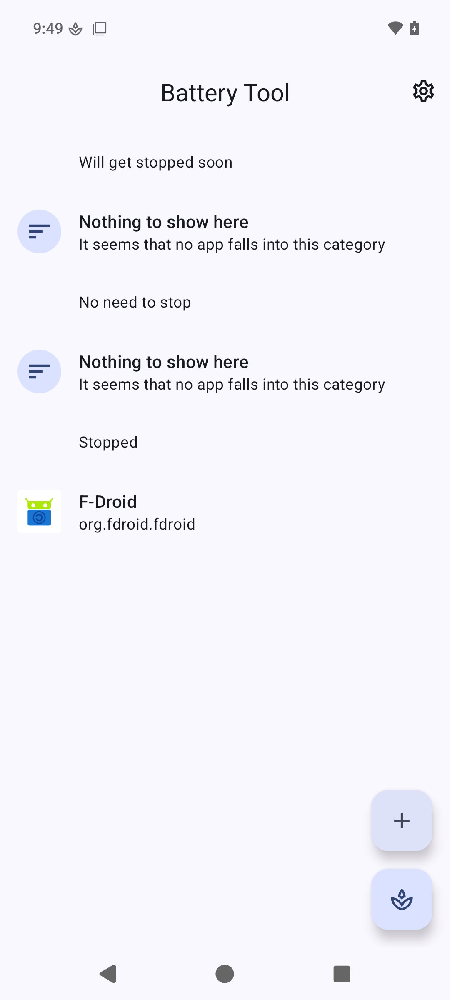
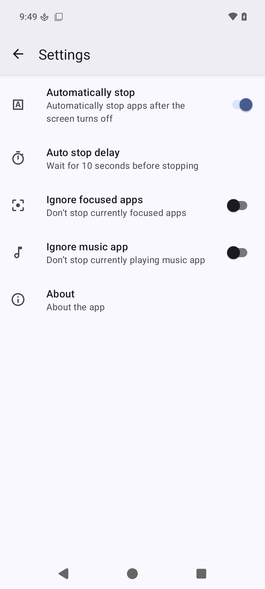
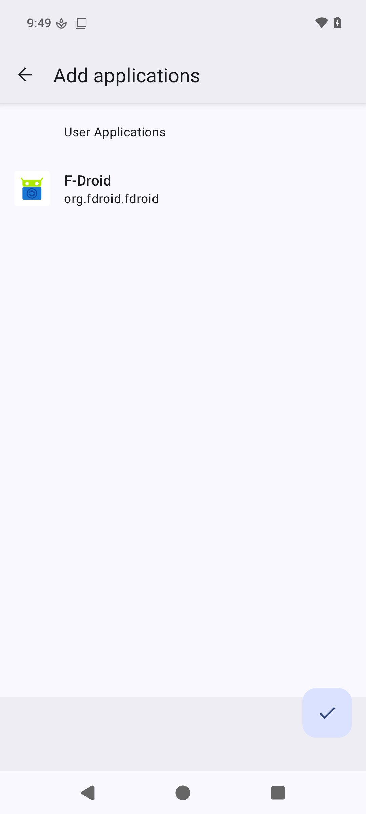

# Battery Tool (fork)

This is a **fork** of [Battery Tool](https://github.com/Domi04151309/BatteryTool) by
[Domi04151309](https://github.com/Domi04151309), released under the GPL-3.0.
All credit for the original app goes to its author; this fork only carries the changes
listed below.

- Upstream: https://github.com/Domi04151309/BatteryTool
- Releases of this fork: https://github.com/bialy39/BatteryTool/releases

Battery Tool helps you save battery by force-stopping apps that keep running in the
background. This app requires root access.
I am not responsible for any damage to your device!

## What is different in this fork

- **Android 17 / API 37** — `targetSdk` 37, edge-to-edge layouts, notification handling
  updated for the current platform.
- **Aggressive doze removed** — the fork no longer touches the device-idle controller.
- **Only user apps can be added** — system apps and the app itself are filtered out of the
  picker, so you cannot accidentally hibernate something the system depends on.
- **Autostart is always blocked for every added app** — there is no per-app toggle
  anymore. After `BOOT_COMPLETED`, `LOCKED_BOOT_COMPLETED` and `USER_UNLOCKED`, and on
  `PACKAGE_ADDED` / `PACKAGE_REPLACED`, autostart of every added app is blocked again.
  A watchdog re-applies the restriction every 60 seconds. An app that is currently in the
  foreground is left alone.
- **New "Running apps" tab** — shows the user apps that are currently running in the
  background, each with a **Kill** button that force-stops it. The app in the foreground
  is never listed, so you cannot kill what you are looking at.
- **New application id** `dev.bialy39.batterytool`, so this fork installs alongside the
  official Battery Tool instead of replacing it.

## Requirements

- Root, provided by KernelSU or Magisk.
- Android 6.0 or newer (`minSdk` 23), `targetSdk` 37.
- Tested on LineageOS 24 on a POCO F5 (marble).

## Installation

1. Download the APK from [Releases](https://github.com/bialy39/BatteryTool/releases).
2. Install it. Because this fork uses the application id `dev.bialy39.batterytool` it can
   live next to the official app; if you previously installed a build under the same id
   with a different signing key, uninstall that build first.
3. Grant root access when asked and add the apps you want to hibernate.

## Building

```
export JAVA_HOME=/path/to/jdk21
export ANDROID_HOME=/path/to/android-sdk
./gradlew assembleDebug assembleRelease
```

Release builds are signed only when the keystore is handed in through environment
variables — `KEYSTORE_FILE`, `KEYSTORE_PASSWORD`, `KEY_ALIAS`, `KEY_PASSWORD`. Without them
`assembleRelease` produces an unsigned APK. No keystore is committed to this repository.

## Previews



<i style="color:gray;">
  Android, Google Play and the Google Play logo are trademarks of Google LLC.
</i>

## License

Copyright (C) 2020 Domi04151309
Modifications in this fork: Copyright (C) 2026 bialy39

This program is free software: you can redistribute it and/or modify
it under the terms of the GNU General Public License as published by
the Free Software Foundation, either version 3 of the License, or
(at your option) any later version.

This program is distributed in the hope that it will be useful,
but WITHOUT ANY WARRANTY; without even the implied warranty of
MERCHANTABILITY or FITNESS FOR A PARTICULAR PURPOSE.  See the
GNU General Public License for more details.

You should have received a copy of the GNU General Public License
along with this program.  If not, see <https://www.gnu.org/licenses/>.

The complete source of this fork is published at
https://github.com/bialy39/BatteryTool and every distributed APK corresponds to a commit
in that repository, as required by the GPL-3.0. The list of changes relative to the
original is in the section "What is different in this fork" above.
